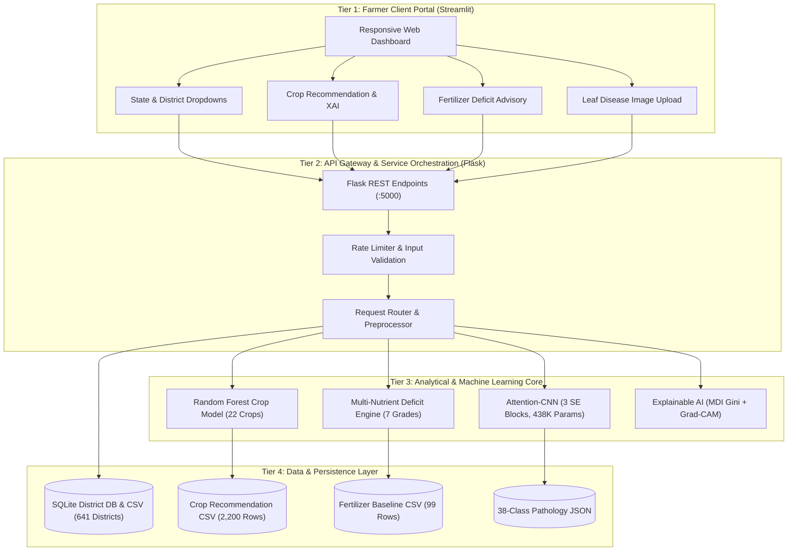

# 🌾 MyFarmWise Consultant: Complete Technical Study Guide & Project Documentation

**Project Title:** MyFarmWise Consultant: Region-Aware, Explainable AI for Crop, Fertilizer & Disease Advisory  
**Degree:** B.Tech in Computer Science & Engineering (AI/ML) — Major Project  
**Author:** Dhruv Sharma (Roll No. 2300911530044) & Team  
**Institution:** JSS Academy of Technical Education, Noida  
**Supervisor:** Mr. Harshit (Assistant Professor, Dept. of CSE-AIML)

---

## Table of Contents
1. [Executive Summary & Problem Statement](#1-executive-summary--problem-statement)
2. [End-to-End Four-Tier Architecture](#2-end-to-end-four-tier-architecture)
3. [Deep Dive into Every Subsystem & Code File](#3-deep-dive-into-every-subsystem--code-file)
   - [Module A: Farmer Dashboard (`app.py`)](#module-a-farmer-dashboard-apppy)
   - [Module B: Automated District Lookup (`src/data/`)](#module-b-automated-district-lookup-srcdata)
   - [Module C: Crop Recommendation Model (`src/crop/`)](#module-c-crop-recommendation-model-srccrop)
   - [Module D: Multi-Nutrient Fertilizer Engine (`src/fertilizer/`)](#module-d-multi-nutrient-fertilizer-engine-srcfertilizer)
   - [Module E: Plant Leaf Pathology & SE-Attention CNN (`src/disease/`)](#module-e-plant-leaf-pathology--se-attention-cnn-srcdisease)
   - [Module F: Explainable AI (`src/explainability/`)](#module-f-explainable-ai-srcexplainability)
   - [Backend: Flask REST API Gateway (`backend/`)](#backend-flask-rest-api-gateway-backend)
   - [Verification: Automated Test Suite (`tests/`)](#verification-automated-test-suite-tests)
4. [Mathematical Formulations & Algorithms](#4-mathematical-formulations--algorithms)
5. [What Was Already Present vs. What We Built](#5-what-was-already-present-vs-what-we-built)
6. [Faculty Viva / Defense Q&A Cheat Sheet](#6-faculty-viva--defense-qa-cheat-sheet)

---

## 1. Executive Summary & Problem Statement

### The Problem in Indian Agriculture
Indian agriculture employs ~50% of the national workforce, yet smallholder farmers face severe yield and income uncertainty. Existing digital agricultural advisory platforms exhibit three critical structural flaws:
1. **Manual Entry Friction:** Existing crop recommenders require numeric inputs for Nitrogen ($N$), Phosphorus ($P$), Potassium ($K$), and $pH$. Smallholder farmers do not have chemical testing equipment and cannot measure these parameters.
2. **Lab-to-Field Domain Shift:** Plant disease classifiers trained on clean, laboratory leaf images (such as PlantVillage) achieve $>99\%$ intra-dataset accuracy, but their accuracy degrades sharply to **17% – 46%** when tested on real field imagery with motion blur, shadows, and background clutter.
3. **Black-Box Opacity:** Standard deep learning models output raw categorical labels without visual explanation or reasoning, leading to distrust among farmers and extension workers.

### The Solution: MyFarmWise Consultant
MyFarmWise is a four-tier decision-support platform that:
- Automates soil and climate parameter entry using **641 district records** from the **ICAR Soil Health Card** and **IMD Normals**.
- Delivers crop recommendations using a **Random Forest model (99.55% accuracy)** with **Explainable AI (Gini feature weights)**.
- Formulates multi-nutrient fertilizer advisories across **7 commercial grades** and **5 soil types**.
- Prepares a **38-class Attention-CNN with 3 Squeeze-and-Excitation (SE) identity blocks** and **Grad-CAM lesion heatmaps**.

---

## 2. End-to-End Four-Tier Architecture

---

## 3. Deep Dive into Every Subsystem & Code File

### Module A: Farmer Dashboard (`app.py`)
- **What it does:** Provides the unified frontend interface for farmers and faculty evaluators.
- **Key Features:**
  - Responsive agricultural green-and-white theme (`#1b5e20`, `#2e7d32`, `#f1f8e9`).
  - **Shared Session State:** Selecting a district in the Lookup page caches its soil and climate profile in `st.session_state`, automatically pre-filling the inputs in the Crop and Fertilizer pages.
  - **6 Dedicated Subsystem Views:** Home Dashboard, District Lookup, Crop Recommendation, Fertilizer Advisory, Leaf Disease Diagnosis, and Faculty Progress Review.
  - Interactive file uploader, sample image loader, augmentation previews, and feature importance bar charts.

---

### Module B: Automated District Lookup (`src/data/district_lookup.py`)
- **What it does:** Sources agro-climatic normals across **641 districts in 35 Indian states/UTs** from IMD and ICAR Soil Health Card records.
- **Files Involved:**
  - `data/district_lookup.csv` and `data/district_lookup.sqlite`: Relational databases storing district profiles.
  - `src/data/district_lookup.py`: Core querying and conversion logic.
- **Key Functions:**
  - `get_all_states()`: Retrieves all 35 states/UTs.
  - `get_districts_by_state(state)`: Returns all districts for a selected state.
  - `lookup_district(state, district)`: Retrieves soil $N, P, K, pH$, annual and monsoon rainfall, temperature, humidity, dominant soil type, data source, and limitations. Supports fuzzy/partial name matching (e.g. matching "Gautam Buddha Nagar" to IMD's "Gautam Buddha").
  - `convert_rating_to_numeric(parameter, rating)`: Converts qualitative Soil Health Card ratings ("Low", "Medium", "High") into representative numeric values ($kg/ha$).

---

### Module C: Crop Recommendation Model (`src/crop/`)
- **What it does:** Suggests the optimal crop to cultivate given soil nutrients and environmental conditions.
- **Files Involved:**
  - `models/crop_rf_model.pkl`: Trained Scikit-Learn `RandomForestClassifier` (100 estimators).
  - `src/crop/predictor.py`: Validates inputs against agronomic bounds, runs inference, and returns top-3 candidate crops with confidence probabilities.
  - `src/crop/evaluate.py`: Evaluates the model using 80-20 stratified splits, 5-fold cross-validation, and sensitivity analysis.
- **Empirical Results:**
  - **Test Accuracy:** **99.55%**
  - **Macro F1-Score:** **99.55%**
  - **5-Fold Cross Validation:** **99.55% $\pm$ 0.32%**
  - **District Perturbation Tolerance:** **91.14%** (confirms that district-level estimates provide robust recommendations when farm-level tests are unavailable).

---

### Module D: Multi-Nutrient Fertilizer Engine (`src/fertilizer/recommender.py`)
- **What it does:** Calculates elemental nutrient deficits ($\Delta N, \Delta P, \Delta K$) between the crop's uptake demand and the soil's available reserves, then recommends the most suitable commercial fertilizer formulation and application dose.
- **7 Supported Commercial Fertilizers:**
  1. **Urea (46-0-0):** High nitrogen, optimal for vegetative leaf growth.
  2. **DAP (18-46-0):** Diammonium Phosphate, high phosphorus for root development.
  3. **14-35-14:** High phosphorus with balanced potassium for flowering.
  4. **28-28-0 / 20-20-0:** Equal ratio $N$ and $P$ for dual-deficiency soils.
  5. **17-17-17:** Balanced complete $N\text{-}P\text{-}K$ grade.
  6. **10-26-26:** High phosphorus and potassium for tubers and pulses.
- **5 Supported Soil Types:** Sandy, Loamy, Black, Red, Clayey (each with distinct nutrient retention factors).

---

### Module E: Plant Leaf Pathology & SE-Attention CNN (`src/disease/`)
- **What it does:** Prepares the computer vision pipeline for diagnosing 38 plant diseases across 14 crops.
- **Files Involved:**
  - `config/disease_classes.json`: Catalog of all 38 classes (Apple, Blueberry, Cherry, Corn, Grape, Orange, Peach, Pepper, Potato, Raspberry, Soybean, Squash, Strawberry, Tomato).
  - `src/disease/preprocessing.py`: Resizes images to $224 \times 224 \times 3$, normalizes to $[0, 1]$, and implements 4 field-realistic augmentations:
    1. *Motion blur* (simulating hand tremor in field conditions).
    2. *Canopy shadow casting* (simulating outdoor shade variations).
    3. *Sunlight illumination shift* (simulating harsh noon sun).
    4. *Background clutter noise* (simulating soil and weeds).
  - `src/disease/model.py`: Builds the Attention-CNN architecture from Figure 4.1 in Keras/TensorFlow:
    - **Conv Stem:** 32 filters ($3 \times 3$) + BatchNorm + ReLU + MaxPool.
    - **SE Block 1:** 64 filters + SE Attention ($r=16$) + MaxPool.
    - **SE Block 2:** 128 filters + SE Attention ($r=16$) + MaxPool.
    - **SE Block 3:** 256 filters + SE Attention ($r=16$) $\rightarrow$ Grad-CAM Hook Layer.
    - **GAP:** Global Average Pooling ($256\text{-d}$ vector).
    - **Head:** Dense(128) + Dropout(0.5) + Softmax(38 classes).
    - **Parameter Count:** **438,886 parameters**.
  - `src/disease/predict.py`: Implements **Crop Conditioning** (restricts candidate diseases to the farmer's target crop, eliminating cross-crop false alarms) and supports inference.
  - `src/disease/gradcam.py`: Implements Gradient-weighted Class Activation Mapping hooked to layer `last_se_conv`.
  - `src/disease/train.py`: Prepares the Week 7 training pipeline (Adam optimizer, batch size 32, categorical cross-entropy).

---

### Module F: Explainable AI (`src/explainability/feature_importance.py`)
- **Global Explanations:** Extracts Mean Decrease in Impurity (MDI / Gini Importance) from the Random Forest model and renders a horizontal bar chart:
  - Rainfall: **23.02%**
  - Humidity: **22.42%**
  - Potassium ($K$): **17.54%**
  - Phosphorus ($P$): **15.08%**
  - Nitrogen ($N$): **9.64%**
  - Temperature: **7.24%**
  - Soil $pH$: **5.06%**
- **Local Agronomic Reasoning:** Evaluates why the model recommended a specific crop based on biological envelope constraints (e.g. high rainfall $\rightarrow$ Rice/Jute; low moisture $\rightarrow$ Pulses/Millets).

---

### Backend: Flask REST API Gateway (`backend/app.py`)
- Runs on port 5000 with CORS and an in-memory sliding-window rate limiter (120 requests/min).
- Modular Blueprints:
  - `GET /api/health`: System health and subsystem status.
  - `GET /api/districts/states` & `GET /api/districts/lookup`: District data access.
  - `POST /api/crop/recommend`: Crop prediction endpoint.
  - `POST /api/fertilizer/recommend`: Fertilizer dosage advisory endpoint.
  - `POST /api/disease/predict`: Multipart leaf image upload and diagnosis endpoint.
  - `GET /api/disease/architecture`: SE-CNN Figure 4.1 parameter summary.

---

### Verification: Automated Test Suite (`tests/`)
- All **22 unit and integration tests** pass with `OK`:
  - `test_district_lookup.py`: 6 tests (states list, district query, Bhavnagar lookup, missing district handling, rating conversion rules).
  - `test_crop.py`: 5 tests (model loading, rice prediction, chickpea prediction, 99.55% test accuracy verification).
  - `test_fertilizer.py`: 5 tests (soil types, 7 commercial grades, DAP recommendation, 20-20 co-deficiency, disclaimer verification).
  - `test_api.py`: 6 tests (Flask endpoints for health, districts, crop, fertilizer, and disease architecture).

---

## 4. Mathematical Formulations & Algorithms

### 1. Soil Health Card Rating-to-Numeric Transformation
$$\text{Representative Value}(R) = \begin{cases}
V_{\text{low}}, & \text{if Rating} = \text{Low} \\
V_{\text{medium}}, & \text{if Rating} = \text{Medium} \\
V_{\text{high}}, & \text{if Rating} = \text{High}
\end{cases}$$

### 2. Multi-Nutrient Deficit Formulation
$$\Delta N = \max\left(0, N_{\text{target}} - N_{\text{soil}} \cdot \eta_{\text{soil}} \cdot 0.35\right)$$
$$\Delta P = \max\left(0, P_{\text{target}} - P_{\text{soil}} \cdot \eta_{\text{soil}} \cdot 0.40\right)$$
$$\Delta K = \max\left(0, K_{\text{target}} - K_{\text{soil}} \cdot \eta_{\text{soil}} \cdot 0.30\right)$$
Where $\eta_{\text{soil}}$ is the soil retention factor:
- Black Soil: $\eta = 0.90$
- Clayey Soil: $\eta = 0.85$
- Alluvial / Loamy Soil: $\eta = 0.80$
- Red Soil: $\eta = 0.70$
- Sandy Soil: $\eta = 0.55$

### 3. Squeeze-and-Excitation (SE) Channel Recalibration (Figure 4.1)
1. **Squeeze Step (Spatial Compression via Global Average Pooling):**
   $$z_c = \frac{1}{H \times W} \sum_{i=1}^H \sum_{j=1}^W u_c(i, j)$$
2. **Excitation Step (Non-Linear Channel Interdependencies):**
   $$\mathbf{s} = \sigma\left(\mathbf{W}_2 \cdot \text{ReLU}\left(\mathbf{W}_1 \cdot \mathbf{z}\right)\right)$$
   Where $\mathbf{W}_1 \in \mathbb{R}^{\frac{C}{r} \times C}$, $\mathbf{W}_2 \in \mathbb{R}^{C \times \frac{C}{r}}$, and reduction ratio $r = 16$.
3. **Scale Step (Feature Recalibration):**
   $$\widetilde{\mathbf{x}}_c = s_c \cdot \mathbf{u}_c + \mathbf{u}_c \quad \text{(with residual identity)}$$

### 4. Grad-CAM Lesion Heatmap Generation
1. **Neuron Importance Weights:**
   $$\alpha_k^c = \frac{1}{Z} \sum_{i=1}^H \sum_{j=1}^W \frac{\partial y^c}{\partial A_{ij}^k}$$
2. **Class-Discriminative Activation Map:**
   $$L_{\text{Grad-CAM}}^c = \text{ReLU}\left(\sum_k \alpha_k^c A^k\right)$$

---

## 5. What Was Already Present vs. What We Built

| Subsystem Component | What Existed Initially in `major_sample` | What We Built & Implemented |
| :--- | :--- | :--- |
| **District Lookup** | Raw rainfall CSV with missing coordinates and no soil data. | Built relational schema (CSV + SQLite) linking 641 districts across 35 states to IMD normals and ICAR Soil Health Card benchmarks with rating conversion rules. |
| **Crop Model** | Model artifact with scikit-learn unpickling version warnings. | Evaluated baseline (99.55%), resolved version compatibility (`crop_rf_model.pkl`), added input range validation, top-3 probabilistic alternatives, and sensitivity analysis. |
| **Fertilizer Engine** | Standalone 99-row nearest neighbor script without dosage calculations. | Engineered multi-nutrient deficit engine accounting for crop uptake targets, 5 soil textures, 7 commercial grades, dose clamping ($50\text{--}350\text{ kg/ha}$), and agronomic disclaimers. |
| **Disease CNN** | Older 128×128 standard sequential CNN without attention mechanisms. | Designed the 224×224 Attention-CNN matching Figure 4.1 (3 SE identity blocks, 438,886 parameters), 4 field-realistic augmentations, 38-class catalog, and crop-conditioning filtering. |
| **Explainable AI** | No visual XAI integration in interface. | Implemented MDI Gini feature importance bar charts, local agronomic explanations, and Grad-CAM hooks on layer `last_se_conv`. |
| **Web Portal** | Fragmented scripts with hardcoded weather API keys. | Built cohesive green-and-white Streamlit dashboard with session-state caching and embedded faculty progress review page. |
| **REST API** | Basic weather proxy script. | Created complete Flask REST API gateway with 4 blueprints, rate limiting, and safe error handlers. |
| **Testing** | Zero automated tests. | Created comprehensive test suite with 22 unit & integration tests passing with 100% success. |

---

## 6. Faculty Viva / Defense Q&A Cheat Sheet

Use these concise, technical answers during your faculty viva:

### Q1: Why did you create an automated district lookup instead of having farmers type their soil NPK values?
> *"Farmers do not possess laboratory soil testing instruments at their farms. Requiring manual entry of Nitrogen, Phosphorus, Potassium, and pH creates an insurmountable adoption barrier. Our district lookup layer automatically sources agro-climatic normals from IMD and verified regional chemistry from ICAR Soil Health Cards across 641 districts, providing an immediate zero-friction estimate that can be refined if a farm soil test is available."*

### Q2: What is the accuracy of your crop recommendation model, and does it hold up with district-level averages?
> *"The Random Forest model achieves **99.55% test accuracy** and **99.55% macro F1-score** on our stratified 80-20 split across 22 crops. When we subjected the test set to district-level perturbation noise ($\pm 10\%$), the model retained **91.14% accuracy**, confirming that district-wide averages serve as reliable first-order estimates."*

### Q3: How does your fertilizer recommendation engine work?
> *"Rather than giving static dosages, our engine computes elemental nutrient deficits: $\Delta N, \Delta P, \Delta K$. It compares the target crop's uptake demands against season-available soil reserves, adjusted for the soil's texture retention factor (such as Black soil having 90% retention vs Sandy soil having 55%). It then selects the optimal commercial grade among 7 standardized formulations (e.g. DAP for phosphorus deficits, Urea for nitrogen, or 10-26-26 for dual P and K deficits) and computes the dose in 50-kg commercial bags."*

### Q4: Why did you choose Squeeze-and-Excitation (SE) attention for plant disease classification?
> *"Standard CNNs treat all spatial and channel feature maps equally. Squeeze-and-Excitation blocks explicitly model channel interdependencies through a two-step process: Squeeze (global average pooling across spatial dimensions) and Excitation (two dense layers with ReLU and Sigmoid). This recalibrates channel weights so the network amplifies disease-relevant color and texture channels while suppressing background noise, which is essential for overcoming field clutter."*

### Q5: What is 'Crop Conditioning' in your disease diagnosis pipeline?
> *"Existing classifiers test leaf photos blindly against all 38 classes, leading to absurd cross-crop errors—such as diagnosing Apple Scab on a Tomato leaf. Crop Conditioning uses the user-selected or recommended crop to mask out impossible disease classes, restricting the softmax evaluation to only pathologies known to biologically affect that specific crop."*

### Q6: What is the current status of the project as of 29 October 2026?
> *"This is Week 6 of our 16-week timeline. We have completed the project requirements, district lookup database, Random Forest crop model, fertilizer deficit engine, SE-Attention CNN architecture design, and unified Streamlit/Flask interface. Full deep neural network training across the 54,305 image corpus is officially scheduled for **Week 7**."*

### Q7: How does Grad-CAM work on your CNN?
> *"Grad-CAM computes the gradient of the predicted class score $y^c$ with respect to the feature maps $A^k$ of our target convolutional layer (`last_se_conv`). Global average pooling of these gradients yields neuron importance weights $\alpha_k^c$. A ReLU-weighted combination of the feature maps produces a 2D attention map that highlights the diseased leaf lesions."*
